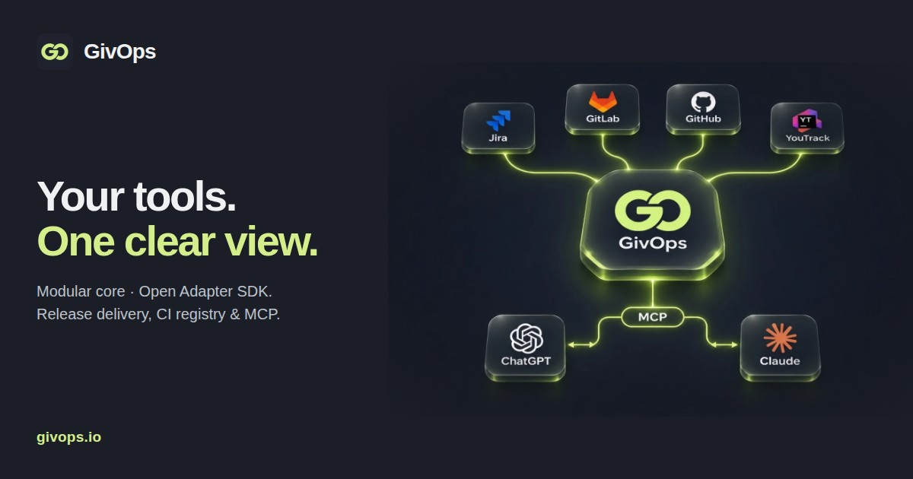
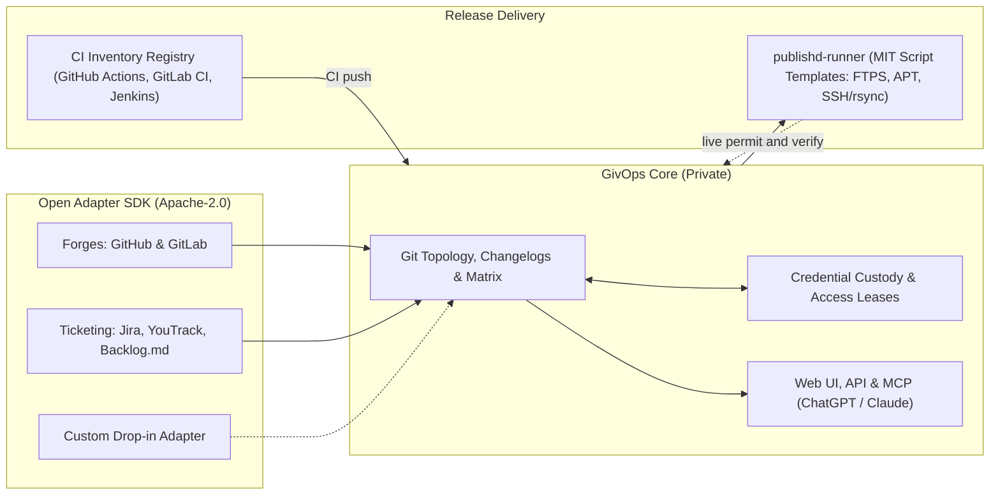
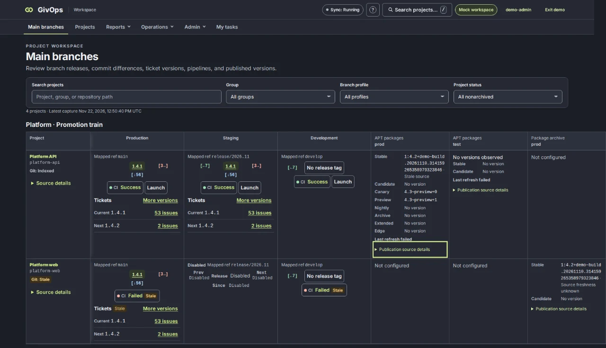
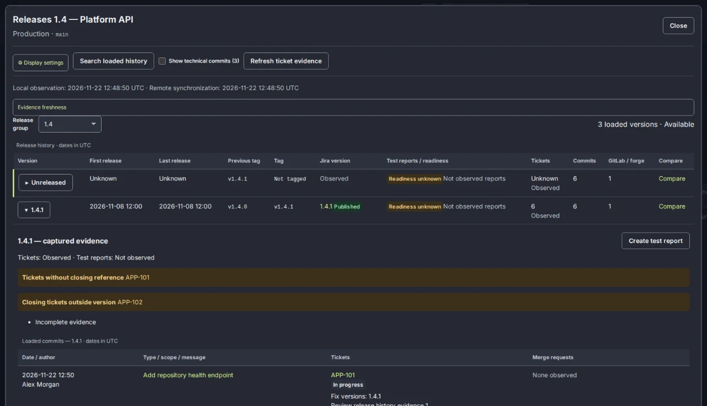

  

  <a href="https://givops.io/">Website (givops.io)</a> ·
  <a href="https://givops.io/open-architecture/">Open Architecture</a> ·
  <a href="https://givops.io/adapter-sdk/">Adapter SDK</a> ·
  <a href="https://givops.io/publishd-runner/">Publishd Runner</a> ·
  <a href="https://givops.io/about/">About</a> ·
  <a href="mailto:contact@givops.io?subject=GivOps%20Pilot%20Partnership">Pilot Program (contact@givops.io)</a>

> [!NOTE]
> **In Active Development · Pilot Partners Wanted** — GivOps is under active development and welcoming interested engineering teams as **pilot partners** to integrate and shape the platform on real-world repositories, issue trackers, and deployment workflows. Reach out at [contact@givops.io](mailto:contact@givops.io?subject=GivOps%20Pilot%20Partnership).

## What is GivOps?

Great software takes many tools; seeing the whole picture shouldn’t. **GivOps** (*Git Versions Operations*) reads Git repository tags and commit topology to bring releases, forge pipelines, issue-tracker context, package channels, and release delivery together in one shared view — accessible from the web workspace, API, and AI assistants (**ChatGPT** and **Claude**) over a read-only **MCP** server.

GivOps follows an **Open-Edge, Private-Core** architecture so teams can extend integrations and customize deployment workflows without modifying or rebuilding the core platform:

- **GivOps Core** *(private)* — Modular Java 25 / Spring Boot 4 backend structured into domain modules (mapped and documented with Spring Modulith with targeted ArchUnit boundary checks). Core indexes Git tag history, correlates commits with tickets, manages encrypted credential custody with short-lived access leases, and powers the web matrix, API, and MCP server — with **zero vendor HTTP code inside Core**.
- **Open Adapter SDK & First-Party Connectors** *(public, Apache-2.0)* — Standalone Java SPI contracts, testkit, and plug-in libraries for forge and ticketing platforms (**GitHub**, **GitLab**, **Jira**, **YouTrack**, **Backlog.md**), built and tested offline without access to private Core source.
- **Publishd Runner Templates & CI Inventory Registry** *(public MIT script templates + private runner / Core registry)* — Self-contained Python 3.11+ starter templates and Script ABI v1 tooling for [`publishd-runner`](https://givops.io/publishd-runner/), alongside passive idempotent deployment reporting straight from existing CI/CD pipelines.

## Architecture at a Glance

## Public Repositories

| Repository | Domain | License | Description |
| --- | --- | --- | --- |
| [`givops/adapter-sdk`](https://github.com/givops/adapter-sdk) | Core SDK & Testkit | Apache-2.0 | Public Java 25 / Spring Boot 4 SPI contracts (`SDK API 0.5`), auto-configuration binding, and standalone offline testkit for forge and ticketing connectors. |
| [`givops/adapter-github`](https://github.com/givops/adapter-github) | Forge · Ticketing | Apache-2.0 | Combined connector for GitHub Cloud and GitHub Enterprise Server: repositories, pull requests, pipelines, issues, and milestones. |
| [`givops/adapter-gitlab`](https://github.com/givops/adapter-gitlab) | Forge · Ticketing | Apache-2.0 | Combined connector for GitLab: projects, merge requests, pipelines, native issues, and milestones. |
| [`givops/adapter-jira`](https://github.com/givops/adapter-jira) | Ticketing | Apache-2.0 | Jira Cloud connector: issues, version membership, configurable test-report extraction, issue history, and release updates. |
| [`givops/adapter-youtrack`](https://github.com/givops/adapter-youtrack) | Ticketing | Apache-2.0 | JetBrains YouTrack connector: issue reads, version tracking, and project, version, and issue provisioning. |
| [`givops/adapter-backlog`](https://github.com/givops/adapter-backlog) | Ticketing | Apache-2.0 | Read-only connector for Git-committed Backlog.md (`v1.55.3`) task files, Markdown bodies, and revision-pinned assets. |
| [`givops/publishd-runner-examples`](https://github.com/givops/publishd-runner-examples) | Release Delivery | MIT | Copy-paste Python 3.11+ starter templates (`ftps`, `apt`, `rsync-ssh`, `local-repository`, `minimal-template`), Script ABI v1 specification, standalone validator, and offline Docker test suite. |

## Product Preview

<table>
  <tr>
    <td width="50%" valign="top">
      
       
      <strong>Release &amp; Package Matrix</strong> 
      View Production, Staging, and Development branches alongside CI status, linked issue counts, and published package channels.
    </td>
    <td width="50%" valign="top">
      
       
      <strong>Release Evidence &amp; Tickets</strong> 
      Correlate Git tags with tracker versions, inspect readiness checks, and spot missing or out-of-band ticket references.
    </td>
  </tr>
</table>

More workspace previews (tag/branch ancestry comparison and the unified focus worklist) are available at [givops.io/#preview](https://givops.io/#preview).

## Extend or Integrate

- **Build a custom forge or ticketing connector:** Start from [`givops/adapter-sdk`](https://github.com/givops/adapter-sdk) using Java 25 and Maven 3.9+ — zero private Core source, database setup, or live vendor account required. See the [Adapter SDK guide](https://givops.io/adapter-sdk/).
- **Wrap a custom deployment target:** Copy any self-contained Python template from [`givops/publishd-runner-examples`](https://github.com/givops/publishd-runner-examples) and validate it locally against Script ABI v1, or push idempotent delivery receipts from your existing CI/CD workflows. See the [Publishd Runner &amp; CI Registry guide](https://givops.io/publishd-runner/).

## Pilot Partnerships & Contact

GivOps is created and developed by [Nicolas Champenois](https://givops.io/about/) ([LinkedIn](https://www.linkedin.com/in/nicolas-champenois/)).

If your engineering team wants unified release visibility across repositories, issue trackers, package channels, or custom delivery targets, let’s talk about an early pilot integration: **[contact@givops.io](mailto:contact@givops.io?subject=GivOps%20Pilot%20Partnership)** · **[givops.io](https://givops.io/)**.

---

© 2026 GivOps · Product names and logos belong to their respective owners.
